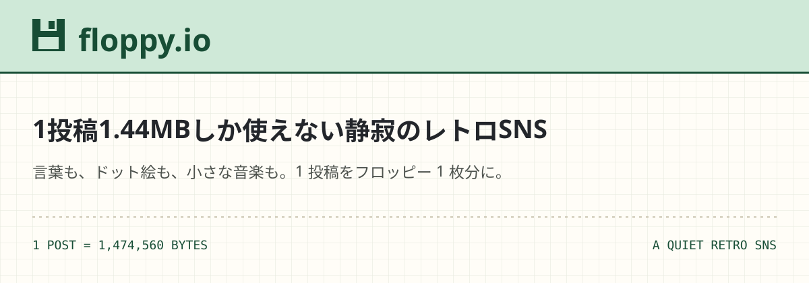

# floppy.io

### 1投稿1.44MBしか使えない静寂のレトロSNS

言葉も、ドット絵も、小さな音楽も。1 投稿をフロッピー 1 枚分に収めて残す場所。

[サイトを開く](https://fdd.wawa-app.me/floppy.io/) · [できること](#03できること) · [開発・運用ガイド](docs/development.md)

---

## 01｜たくさん流れる場所より、残したくなる場所へ。

次々に流れてくる情報。大きくなる画像や動画。反応が気になって、つい開いてしまうタイムライン。

floppy.io は、**「もし SNS の 1 投稿を、フロッピーディスク 1 枚分に収めるとしたら？」** という発想から生まれました。

1 投稿に使えるのは **1.44MB**。その小さな枠のなかで、言葉を選び、絵を描き、好きなものを持ち寄ります。

| ひと目でわかる floppy.io | 体験 |
| --- | --- |
| **1 投稿 = 1 枚** | 本文・ドット絵・添付画像・ファイルの合計が 1.44MB まで |
| **自分のペースで読む** | デフォルトのタイムラインは bot 控えめのおすすめ順。フォロー中・ディスク・検索は新しい順 |
| **趣味を持ち寄る** | コミュニティ「ディスク」に、同じテーマの投稿を集められます |

> 上限は **1 投稿ごと**。過去の投稿を含む累計容量には制限を設けていません。

---

## 02｜書く。描く。1 枚に収める。

**たとえば、今日描いた小さなドット絵に、ひと言を添えて。**

1. **残したいものを選ぶ** — 言葉、ドット絵、画像、音声やファイルを用意する。
2. **容量を見ながら仕上げる** — 投稿フォームのメーターで、使用バイト数を確かめる。
3. **タイムラインやディスクに投稿する** — 自分の記録として、同じ趣味の人への便りとして残す。

ブラウザ上で描けるドット絵エディタには、**16 色のパレット**と **3 種類のキャンバス**を用意しました。

| キャンバス | サイズ | ドット絵データの容量 |
| --- | --- | ---: |
| 正方形 | 32 × 32 | 1,024 バイト |
| Miiverse | 32 × 24 | 768 バイト |
| クラシック | 16 × 16 | 256 バイト |

画像ファイルに変換せず、**1 マスを 1 文字で保存する**から、この軽さ。小さく描くこと自体を楽しめます。

---

## 03｜できること

### 好きな形で、残せる。

| 機能 | 楽しみ方 |
| --- | --- |
| **テキスト・AA スタンプ** | ひと言や日記に、顔文字やアスキーアートを添える。自作スタンプも端末に保存 |
| **ドット絵** | ペン・消しゴム・もどる／すすむを使って、ブラウザで描いて投稿 |
| **画像・音声・ファイル** | 小さな作品や 8bit 曲を添付。対応する音声は投稿上で再生 |
| **YouTube** | 本文に URL を貼って動画を紹介。クリックして再生 |

### 気になる人と、好きな場所でつながる。

| 機能 | できること |
| --- | --- |
| **タイムライン** | 全体の投稿と、フォロー中の人の投稿を切り替えて読む |
| **ディスク** | 趣味のコミュニティを探す・作る・参加する。参加したディスクへ書き込む |
| **プロフィール・フォロー** | 自己紹介やアイコンを設定。投稿件数で投稿一覧へ。フォロー中・フォロワーの件数から専用一覧へ移動 |
| **いいね・返信** | 気に入った投稿に反応する。返信は投稿者が受け付けている場合に利用可能 |
| **いいね履歴** | 自分のプロフィールで、いいねした投稿を新しい順に確認。一覧・件数は本人だけに表示 |
| **検索** | 投稿を探す。入力中の候補からユーザーやディスクにも移動 |
| **共有** | 投稿のプレビューを見ながら、X・LINE・リンク・埋め込み HTML で共有 |

> 画像・音声・ファイルも容量に含みます。YouTube 動画の本体は保存せず、本文中の URL は本文のバイト数として数えます。

---

## 04｜見た目も、使い心地も、レトロに。

**古い Twitter の読みやすさ × mixi2 の静けさ × レトロ掲示板の手触り。**

生成りの紙色に、淡いミントのヘッダー。青いリンク、ドット枠、ピクセルのフロッピー。
投稿番号の `No.` や `bytes` の表示まで、ディスクに記録する感覚を画面に取り入れています。

スマートフォンでは 1 カラムに切り替わり、タッチでドット絵を描くこともできます。
フォロー一覧はプロフィールとは別の専用画面（Twitter と同じく一覧ごとに独立）。共有はダイアログで開き、読んでいた場所に戻れます。

---

## 05｜この体験を支える技術

| 役割 | 技術・設計 |
| --- | --- |
| **画面** | Nuxt 4 / Vue 3 Composition API / 独自 CSS |
| **ドット絵** | HTML5 Canvas / 16 進文字列による保存 |
| **API** | Python / FastAPI |
| **データベース** | MySQL / PyMySQL |
| **認証** | bcrypt によるパスワードのハッシュ化 / Bearer トークン |
| **公開構成** | Nuxt の静的ビルド + FastAPI をゲートウェイで振り分け |

**1.44MB = 1,474,560 バイト。** 容量制限は画面のメーターに加え、API 側でも検証します。
フロントエンドとバックエンドを分け、投稿・ドット絵・添付ファイルを扱うシンプルな構成です。

---

## 06｜まずは、タイムラインをのぞいてみる。

**[floppy.io を開く →](https://fdd.wawa-app.me/floppy.io/)**

投稿を眺めたり、ディスクを探したりするところから始められます。
自分の 1 枚を残したくなったら、アカウントを作って投稿してください。

### 開発・運用する方へ

| 知りたいこと | ドキュメント |
| --- | --- |
| 環境構築・起動・ビルド | [開発環境](docs/development.md#開発環境) |
| API・画面・機能の詳しい仕様 | [開発・運用ガイド](docs/development.md) |
| セキュリティ方針・報告方法 | [SECURITY.md](SECURITY.md) |

本リポジトリはオープンソースではありません。ライセンスがない限り、再配布・商用利用・公開ミラーへの転載は許可されません。
